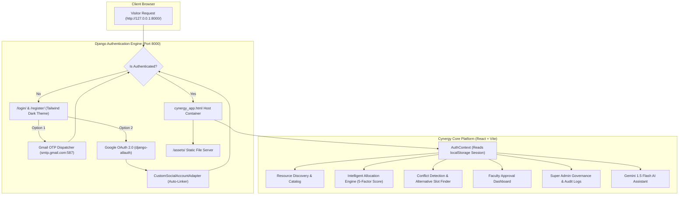
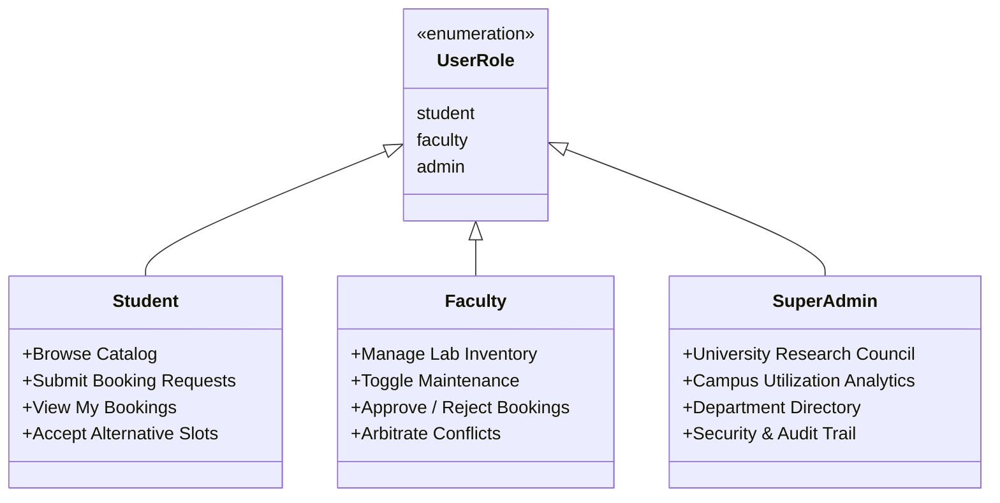
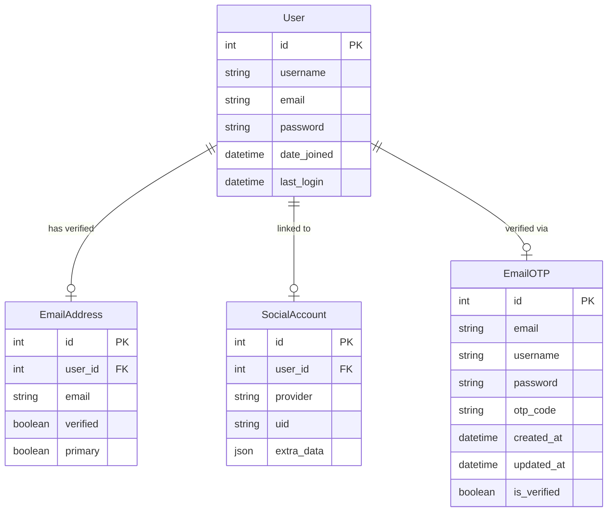

# LabLink (Cynergy) & Django Enterprise Authentication Platform
## Comprehensive Technical Documentation & Architecture Specification

---

## 📑 Table of Contents
1. [Executive Summary & System Architecture](#1-executive-summary--system-architecture)
2. [Cynergy (LabLink) — The Core Platform](#2-cynergy-lablink--the-core-platform)
   - [2.1 Mission & Problem Statement](#21-mission--problem-statement)
   - [2.2 Core Modules & User Flows](#22-core-modules--user-flows)
   - [2.3 Multi-Factor Intelligent Allocation Engine](#23-multi-factor-intelligent-allocation-engine)
   - [2.4 Automated Conflict Detection & Alternative Slot Finder](#24-automated-conflict-detection--alternative-slot-finder)
   - [2.5 Gemini AI Laboratory Assistant](#25-gemini-ai-laboratory-assistant)
   - [2.6 Role-Based Access Control (RBAC)](#26-role-based-access-control-rbac)
   - [2.7 Client Storage & Reactive State Architecture](#27-client-storage--reactive-state-architecture)
3. [Django Authentication Subsystem (Gatekeeper)](#3-django-authentication-subsystem-gatekeeper)
   - [3.1 Gmail OTP Verification Flow](#31-gmail-otp-verification-flow)
   - [3.2 OTP Expiry & Anti-Spam Resend Cooldown](#32-otp-expiry--anti-spam-resend-cooldown)
   - [3.3 Google OAuth 2.0 Sign-In (`django-allauth`)](#33-google-oauth-20-sign-in-django-allauth)
   - [3.4 Seamless Social Account Auto-Linking](#34-seamless-social-account-auto-linking)
   - [3.5 Django-to-React Session Synchronization](#35-django-to-react-session-synchronization)
   - [3.6 React Router Deep-Linking Route Guards](#36-react-router-deep-linking-route-guards)
4. [Complete Project File Manifest](#4-complete-project-file-manifest)
5. [Data Models & TypeScript Interfaces](#5-data-models--typescript-interfaces)
   - [5.1 Django Backend Models](#51-django-backend-models)
   - [5.2 Cynergy TypeScript Data Models](#52-cynergy-typescript-data-models)
6. [API & URL Routing Specifications](#6-api--url-routing-specifications)
7. [Environment Configuration & Credentials Setup](#7-environment-configuration--credentials-setup)
   - [7.1 Django `.env` File Reference](#71-django-env-file-reference)
   - [7.2 Gmail SMTP 16-Digit App Password Setup](#72-gmail-smtp-16-digit-app-password-setup)
   - [7.3 Google Cloud Console OAuth 2.0 Setup](#73-google-cloud-console-oauth-20-setup)
   - [7.4 Gemini AI API Key Setup (Optional)](#74-gemini-ai-api-key-setup-optional)
8. [Installation, Build & Execution Guide](#8-installation-build--execution-guide)
9. [Automated Testing & Verification](#9-automated-testing--verification)
10. [Troubleshooting & Frequently Asked Questions](#10-troubleshooting--frequently-asked-questions)

---

## 1. Executive Summary & System Architecture

This project is a unified, full-stack campus laboratory resource management system. It seamlessly bridges two specialized components:

1. **The Core Platform: Cynergy (LabLink)**:
   A modern, production-grade web application built in **React 18, Vite, TypeScript, and Tailwind CSS**. It manages inter-departmental laboratory resource discovery, intelligent slot scheduling, conflict arbitration, faculty approvals, and real-time utilization analytics.
2. **The Security Gatekeeper: Django Authentication Engine**:
   A robust backend built with **Django 6.1, `django-allauth`, and `python-dotenv`**. It secures the Cynergy application behind dual enterprise authentication paths: **Gmail OTP verification** and **Google OAuth 2.0**, auto-links accounts, and passes authenticated user sessions directly to Cynergy.

### High-Level Architecture Diagram



---

## 2. Cynergy (LabLink) — The Core Platform

### 2.1 Mission & Problem Statement
Universities possess expensive, high-demand equipment (e.g. **NVIDIA A100 GPUs, 5-Axis CNC Milling Machines, Vector Network Analyzers, Selective Laser Sintering 3D Printers**) distributed across departmental silos.
- **The Challenge**: Students and researchers frequently encounter equipment hoarding, double-booking, scheduling collisions near capstone deadlines, and opaque manual approval processes.
- **The Cynergy Solution**: A unified campus-wide digital clearinghouse providing real-time hardware discovery, objective multi-factor priority allocation, automated conflict resolution, and compliance audit logging.

---

### 2.2 Core Modules & User Flows

Cynergy provides dedicated pages located in `cynergy/src/pages/`:

| Page Component | Route | Key Functionality |
|---|---|---|
| `ResourceDiscoveryPage.tsx` | `/resources` | Filterable catalog by department (AI&DS, CSE, ECE, MECH, EEE, CIVIL), category, availability status, and keyword search. |
| `ResourceDetailPage.tsx` | `/resources/:id` | Full technical specifications, operational hours, active maintenance windows, faculty in-charge info, and booking launcher. |
| `BookingRequestPage.tsx` | `/bookings/new` | Multi-step booking request form with live priority score preview, justification, and deadline input. |
| `MyBookingsPage.tsx` | `/my-bookings` | Personal booking tracking, status badges (Approved, Pending, Alternative Suggested, Rejected), cancellation trigger. |
| `FacultyApprovalsPage.tsx` | `/faculty/approvals` | Faculty queue showing incoming student booking requests with computed scores, conflict warnings, and 1-click approvals. |
| `ConflictResolutionPage.tsx` | `/faculty/conflicts` | Visual timeline of overlapping bookings with recommended resolution options and manual overrides. |
| `FacultyResourcesPage.tsx` | `/faculty/resources` | Equipment management suite for lab coordinators; allows adding items and toggling maintenance windows. |
| `AnalyticsPage.tsx` | `/analytics` | Utilization charts, departmental usage shares, and peak operating hours powered by **Recharts**. |
| `SuperAdminPage.tsx` | `/admin` | University Research Council dashboard showing institution-wide statistics, department directory, and tamper-evident audit logs. |
| `LandingPage.tsx` | `/overview` | Public platform overview explaining the allocation philosophy and campus impact. |

---

### 2.3 Multi-Factor Intelligent Allocation Engine

Located at [`cynergy/src/features/allocation/allocationEngine.ts`](file:///c:/Users/prati/OneDrive/Desktop/Documents/PROMTWARS/cynergy/src/features/allocation/allocationEngine.ts), the engine evaluates competing requests objectively across **5 weighted factors**:

$$\text{Total Score} = S_{\text{deadline}} + S_{\text{suitability}} + S_{\text{academic}} + S_{\text{waiting}} + S_{\text{fairness}}$$

```
┌────────────────────────────────────────────────────────────────────────┐
│               ALLOCATION ENGINE FACTOR BREAKDOWN (0 - 100)             │
├───────────────────────┬────────┬───────────────────────────────────────┤
│ Factor Name           │ Weight │ Evaluation Metric                     │
├───────────────────────┼────────┼───────────────────────────────────────┤
│ 1. Deadline Urgency   │  30%   │ Days remaining until submission date  │
│ 2. Task Suitability   │  25%   │ Match between specs & task workload   │
│ 3. Academic Priority  │  20%   │ Capstone/Funded Research vs Exercise  │
│ 4. Waiting Time       │  15%   │ Hours elapsed since request submission│
│ 5. Fairness History   │  10%   │ Inverse of user's past 30-day hours   │
└───────────────────────┴────────┴───────────────────────────────────────┘
```

#### Factor Scoring Rules
1. **Deadline Urgency (Max 30 pts)**:
   - Due in $\le 2$ days: **30 pts**
   - Due in $3 - 5$ days: **24 pts**
   - Due in $6 - 10$ days: **16 pts**
   - Due in $> 10$ days: **8 pts**
2. **Task Suitability (Max 25 pts)**:
   - High compute/high precision match (e.g., LLM training on A100): **25 pts**
   - Moderate workload: **18 pts**
   - Basic task that could use lower-tier equipment: **10 pts**
3. **Academic Priority (Max 20 pts)**:
   - Sponsored Research / Ph.D. Thesis: **20 pts**
   - Undergraduate Final Year Capstone: **16 pts**
   - Post-Graduate Coursework: **12 pts**
   - General Exploration / Hobby: **6 pts**
4. **Waiting Time (Max 15 pts)**:
   - Waiting $> 72$ hours: **15 pts**
   - Waiting $48 - 72$ hours: **12 pts**
   - Waiting $24 - 48$ hours: **8 pts**
   - Waiting $< 24$ hours: **4 pts**
5. **Fairness History (Max 10 pts)**:
   - $\le 4$ hours booked in last 30 days: **10 pts** (rewards new/infrequent users)
   - $5 - 15$ hours booked: **7 pts**
   - $> 15$ hours booked: **3 pts** (prevents resource monopolization)

---

### 2.4 Automated Conflict Detection & Alternative Slot Finder

When two or more bookings request overlapping time windows on the same equipment:

```typescript
export function isTimeOverlapping(startA: string, endA: string, startB: string, endB: string): boolean {
  return startA < endB && endA > startB;
}
```

If a conflict or maintenance window is detected:
1. The allocation engine flags the conflict in `ConflictResolutionPage.tsx`.
2. It executes `generateAlternativeSlots()`, searching for the nearest available time blocks on that resource within the next 7 operational days.
3. It ranks alternative slots by feasibility rank (1 = closest to original requested time).
4. Students can accept alternative slots with a single click from `MyBookingsPage.tsx`.

---

### 2.5 Gemini AI Laboratory Assistant

Located at [`cynergy/src/services/geminiService.ts`](file:///c:/Users/prati/OneDrive/Desktop/Documents/PROMTWARS/cynergy/src/services/geminiService.ts) and accessible via the floating AI button (`AiAssistantModal.tsx`):
- **Live Mode**: When `VITE_GEMINI_API_KEY` is set, calls **Google Gemini 1.5 Flash** with a system prompt detailing available campus equipment, specifications, and laboratory rules.
- **Deterministic Reasoning Engine (Zero-Config Fallback)**: If no API key is present or when offline, an integrated natural language parser cross-references user queries (e.g., *"I need to train a vision transformer model"*, *"where can I 3D print a drone arm"*, *"spectrum analyzer for 5GHz"*) directly against `INITIAL_RESOURCES` and suggests the exact matching campus hardware.

---

### 2.6 Role-Based Access Control (RBAC)

Cynergy defines three distinct user personas in `cynergy/src/types/index.ts`:



---

### 2.7 Client Storage & Reactive State Architecture

The application uses an event-driven storage manager in [`cynergy/src/services/storageService.ts`](file:///c:/Users/prati/OneDrive/Desktop/Documents/PROMTWARS/cynergy/src/services/storageService.ts):
- Persists items to `localStorage` under distinct versioned namespaces (`lablink_resources_v1`, `lablink_bookings_v1`, `lablink_audit_logs_v1`, etc.).
- Dispatches a custom window event `lablink_storage_update` on every mutation.
- UI components reactively re-render whenever bookings are approved or equipment status changes without requiring page refreshes.

---

## 3. Django Authentication Subsystem (Gatekeeper)

The Django backend sits in front of Cynergy as an enterprise authentication proxy.

### 3.1 Gmail OTP Verification Flow
1. User enters **Username**, **Email**, and **Password** on `/register/`.
2. Django verifies:
   - Username does not already exist in `auth_user`.
   - Email address does not already exist in `auth_user`.
   - Passwords match and satisfy length requirements ($\ge 6$ chars).
3. A secure 6-digit passcode is generated using Python's `secrets.randbelow(900000) + 100000`.
4. Password is pre-hashed using Django's PBKDF2 algorithm (`make_password`) and stored alongside the OTP in `accounts_emailotp`.
5. The email dispatcher in `accounts/utils.py` sends an email via Gmail SMTP:
   - **Host**: `smtp.gmail.com`
   - **Port**: `587` (TLS)
   - **Subject**: *"Your Verification Code - Django Auth Demo"*
6. User is redirected to `/verify-otp/`. Upon submitting the correct code, the user account is created in `auth_user`, authenticated via `login()`, and redirected to `/`.

---

### 3.2 OTP Expiry & Anti-Spam Resend Cooldown

- **Expiry (300 Seconds)**:
  OTPs expire after 5 minutes. The verification screen calculates remaining time via `otp_obj.seconds_until_expiration()` and displays an interactive JavaScript countdown timer.
- **Anti-Spam Cooldown (60 Seconds)**:
  Users cannot repeatedly trigger OTP emails. The "Resend OTP" button is disabled for 60 seconds with an active countdown. Server-side validation rejects premature resend requests.

---

### 3.3 Google OAuth 2.0 Sign-In (`django-allauth`)

Integrated using `django-allauth`:
- **Login Initiation**: User clicks "Continue with Google" on `/login/` or `/register/`, pointing to `` (`/accounts/google/login/`).
- **Google Authorization**: Redirects to `accounts.google.com` requesting `profile` and `email` scopes.
- **Callback Handling**: Google redirects to `http://127.0.0.1:8000/accounts/google/login/callback/`. Allauth exchanges the authorization code for an ID token and accesses user profile details.

---

### 3.4 Seamless Social Account Auto-Linking

In standard setups, an error occurs if a user signs in with Google using an email that already exists in Django.
In this project, [`accounts/adapters.py`](file:///c:/Users/prati/OneDrive/Desktop/Documents/PROMTWARS/accounts/adapters.py) implements `CustomSocialAccountAdapter`:
```python
class CustomSocialAccountAdapter(DefaultSocialAccountAdapter):
    def pre_social_login(self, request, sociallogin):
        if sociallogin.is_existing:
            return

        # Extract verified email from Google OAuth
        email = None
        if sociallogin.email_addresses:
            for email_address in sociallogin.email_addresses:
                if email_address.email:
                    email = email_address.email.strip().lower()
                    break
        elif 'email' in sociallogin.account.extra_data:
            email = sociallogin.account.extra_data['email'].strip().lower()

        if not email:
            return

        # Link to existing local user account
        user = User.objects.filter(email__iexact=email).first()
        if user:
            EmailAddress.objects.get_or_create(
                user=user,
                email=user.email,
                defaults={'verified': True, 'primary': True}
            )
            sociallogin.connect(request, user)
```
This bypasses all intermediate confirmation screens, instantly authenticates the user, and redirects to Cynergy.

---

### 3.5 Django-to-React Session Synchronization

When an authenticated user lands on `/`, Django serves [`templates/cynergy_app.html`](file:///c:/Users/prati/OneDrive/Desktop/Documents/PROMTWARS/templates/cynergy_app.html). Before React boots, Django populates `lablink_current_user_v1` in `localStorage`:
```html
<script>
  (function() {
    try {
      const authUser = {
        uid: "user-{{ user.id }}",
        name: "{{ user.username }}",
        email: "{{ user.email|default:user.username }}",
        role: "student",
        department: "Artificial Intelligence & Data Science",
        createdAt: "{{ user.date_joined|date:'c' }}"
      };
      localStorage.setItem('lablink_current_user_v1', JSON.stringify(authUser));
    } catch (err) {
      console.warn("Storage sync warning:", err);
    }
  })();
</script>
```
When Cynergy's `AuthContext` initializes, it finds this user and renders the authenticated platform shell.

---

### 3.6 React Router Deep-Linking Route Guards

Because Cynergy utilizes HTML5 client-side routing (`react-router-dom`), refreshing on URLs like `/resources` or `/my-bookings` would cause Django to return a 404 error if unhandled.
In [`accounts/urls.py`](file:///c:/Users/prati/OneDrive/Desktop/Documents/PROMTWARS/accounts/urls.py):
```python
re_path(r'^(?:resources|bookings|my-bookings|faculty|analytics|admin-portal|overview).*$', views.home_view, name='cynergy_routes')
```
- Protected by `@login_required(login_url='login')`.
- Authenticated requests return the Cynergy container, allowing React Router to render the appropriate page.
- Unauthenticated requests are redirected to `/login/?next=<path>`.

---

## 4. Complete Project File Manifest

```
PROMTWARS/
│
├── manage.py                          # Django execution CLI
├── requirements.txt                   # Backend dependencies (Django, allauth, dotenv, cryptography)
├── .env                               # Active secrets & credentials (gitignored)
├── .env.example                       # Reference environment template
├── .gitignore                         # Git exclusion rules
├── README.md                          # Quickstart summary
├── PROJECT_DOCUMENTATION.md           # This master documentation file
│
├── auth_demo/                         # Django Core Module
│   ├── settings.py                    # Settings: dotenv, allauth, static directories, email config
│   ├── urls.py                        # Root routes + Vite static asset server
│   ├── wsgi.py                        # WSGI entrypoint
│   └── asgi.py                        # ASGI entrypoint
│
├── accounts/                          # Authentication Subsystem
│   ├── models.py                      # EmailOTP model with expiry and cooldown logic
│   ├── forms.py                       # RegisterForm, LoginForm, VerifyOTPForm
│   ├── views.py                       # HTTP handlers for auth lifecycle and Cynergy serving
│   ├── urls.py                        # URL patterns for accounts + Cynergy client routes
│   ├── utils.py                       # Gmail SMTP dispatcher with console fallback
│   ├── adapters.py                    # CustomSocialAccountAdapter for OAuth auto-linking
│   ├── admin.py                       # Admin panel registration for EmailOTP
│   └── tests.py                       # Automated test suite (12 tests)
│
├── templates/                         # HTML Templates
│   ├── base.html                      # Layout, dark theme, navigation header, toast messages
│   ├── cynergy_app.html               # Shell hosting Cynergy React app + session bar
│   ├── accounts/
│   │   ├── login.html                 # Login page + Google OAuth button
│   │   ├── register.html              # Registration form + Google OAuth button
│   │   ├── verify_otp.html            # 6-digit OTP form + live JS countdown timer
│   │   └── home.html                  # Profile overview backup
│   └── socialaccount/
│       └── signup.html                # Styled fallback for Google OAuth profile completion
│
└── cynergy/                           # Core Platform: LabLink React + Vite
    ├── package.json                   # Dependencies (React, Vite, Recharts, Lucide, Tailwind)
    ├── vite.config.ts                 # Vite compiler settings
    ├── tsconfig.json                  # TypeScript compiler settings
    ├── tailwind.config.js             # Tailwind design system configuration
    ├── firestore.rules                # Firebase Firestore security rules
    ├── .env.example                   # Client environment variables (VITE_GEMINI_API_KEY)
    │
    ├── src/                           # Frontend Source Code
    │   ├── App.tsx                    # Main router: Protected routes & layout wiring
    │   ├── main.tsx                   # React root hydration entrypoint
    │   ├── index.css                  # Custom styling & font declarations
    │   │
    │   ├── types/
    │   │   └── index.ts               # Domain interfaces (Resources, Bookings, Scores, Users)
    │   │
    │   ├── data/
    │   │   └── seedData.ts            # Realistic campus equipment, departments, and seed data
    │   │
    │   ├── features/
    │   │   └── allocation/
    │   │       ├── allocationEngine.ts # 5-factor scoring algorithm & conflict detector
    │   │       └── __tests__/
    │   │           └── allocationEngine.test.ts # Vitest unit tests for allocation math
    │   │
    │   ├── services/
    │   │   ├── storageService.ts      # Reactive storage service (localStorage + events)
    │   │   └── geminiService.ts       # Gemini AI lab advisor & deterministic fallback
    │   │
    │   ├── context/
    │   │   └── AuthContext.tsx        # React authentication provider & role manager
    │   │
    │   ├── components/
    │   │   ├── ai/
    │   │   │   └── AiAssistantModal.tsx # Interactive AI chat assistant widget
    │   │   └── layout/
    │   │       ├── AppLayout.tsx      # Main authenticated app frame with sidebar & navbar
    │   │       ├── Navbar.tsx         # Top bar with role switcher, search, notifications
    │   │       └── Sidebar.tsx        # Navigation sidebar with route indicators
    │   │
    │   └── pages/
    │       ├── ResourceDiscoveryPage.tsx  # Catalog of all campus laboratory equipment
    │       ├── ResourceDetailPage.tsx     # Equipment specs, maintenance windows, booking
    │       ├── BookingRequestPage.tsx     # Submission form with live score calculation
    │       ├── MyBookingsPage.tsx         # Booking history, status tracking, cancellations
    │       ├── FacultyApprovalsPage.tsx   # Faculty approval queue & conflict alerts
    │       ├── ConflictResolutionPage.tsx # Collision arbitration timeline & overrides
    │       ├── FacultyResourcesPage.tsx   # Equipment inventory management & maintenance
    │       ├── AnalyticsPage.tsx          # Campus utilization charts & department shares
    │       ├── SuperAdminPage.tsx         # Governance console, departments, audit logs
    │       ├── LoginPage.tsx              # Standalone client login view
    │       └── LandingPage.tsx            # Public platform overview
    │
    └── dist/                          # Production Build (served by Django)
        ├── index.html                 # Compiled HTML entry
        └── assets/
            ├── index-CIa1PZH8.css     # Compiled styles (38.7 KB)
            └── index-DKOiIXx1.js      # Compiled application bundle (777.8 KB)
```

---

## 5. Data Models & TypeScript Interfaces

### 5.1 Django Backend Models



---

### 5.2 Cynergy TypeScript Data Models

Key interfaces defined in [`cynergy/src/types/index.ts`](file:///c:/Users/prati/OneDrive/Desktop/Documents/PROMTWARS/cynergy/src/types/index.ts):

```typescript
export type UserRole = 'student' | 'faculty' | 'admin';

export interface LabResource {
  id: string;
  name: string;
  category: 'Workstation / GPU' | 'Embedded & IoT' | 'Prototyping & Fabrication' | 
            'Testing & Measurement' | 'Robotics & Automation' | 'High-Performance Computing';
  departmentId: string;
  departmentName: string;
  description: string;
  specifications: Record<string, string>;
  location: string;
  imageUrl: string;
  quantity: number;
  status: 'available' | 'in-use' | 'maintenance' | 'reserved';
  maintenanceWindows: { id: string; start: string; end: string; reason: string }[];
  operatingHours: { start: string; end: string };
  facultyContact: { name: string; email: string; phone?: string };
  capabilities: string[];
}

export interface BookingRequest {
  id: string;
  studentId: string;
  studentName: string;
  studentEmail: string;
  studentDepartment: string;
  resourceId: string;
  resourceName: string;
  projectTitle: string;
  projectDescription: string;
  academicPriority: 'Capstone Project' | 'Funded Research' | 'Coursework Lab' | 'Self-Directed / Club';
  projectDeadline: string;
  requestedDate: string;
  startTime: string;
  endTime: string;
  status: 'pending' | 'approved' | 'rejected' | 'alternative_suggested' | 'cancelled' | 'completed';
  scoreBreakdown?: ScoreBreakdown;
  hasConflict?: boolean;
}

export interface ScoreBreakdown {
  deadlineScore: number;        // Max 30 points
  suitabilityScore: number;     // Max 25 points
  academicPriorityScore: number;// Max 20 points
  waitingTimeScore: number;     // Max 15 points
  fairnessScore: number;        // Max 10 points
  totalScore: number;           // 0 - 100 points
}
```

---

## 6. API & URL Routing Specifications

| Route Pattern | Target Handler | HTTP Methods | Access Level | Description |
|---|---|---|---|---|
| `/` | `accounts.views.home_view` | GET | Authenticated | Serves Cynergy (LabLink) React shell with authenticated session |
| `/login/` | `accounts.views.login_view` | GET, POST | Public | Standard login with username/email & password + Google button |
| `/register/` | `accounts.views.register_view` | GET, POST | Public | Validates user, generates 6-digit OTP, dispatches Gmail email |
| `/verify-otp/` | `accounts.views.verify_otp_view` | GET, POST | Public (Session) | Verifies OTP code, creates User, and logs in |
| `/resend-otp/` | `accounts.views.resend_otp_view` | POST | Public (Session) | Enforces 60s cooldown and sends fresh 6-digit OTP code |
| `/logout/` | `accounts.views.logout_view` | GET, POST | Authenticated | Terminates user session, flushes cookies, redirects to `/login/` |
| `/accounts/google/login/` | `allauth.socialaccount.views.login` | GET, POST | Public | Initiates OAuth 2.0 redirect to Google Identity Services |
| `/accounts/google/login/callback/` | `allauth.socialaccount.views.callback`| GET | Public | Handles OAuth callback from Google and links user |
| `/assets/<path>` | `django.views.static.serve` | GET | Public | Serves compiled Cynergy JavaScript and CSS Vite assets |
| `/resources*` | `accounts.views.home_view` | GET | Authenticated | React Router client route guard for catalog pages |
| `/bookings*` | `accounts.views.home_view` | GET | Authenticated | React Router client route guard for booking flows |
| `/faculty*` | `accounts.views.home_view` | GET | Authenticated | React Router client route guard for faculty approval views |
| `/analytics*` | `accounts.views.home_view` | GET | Authenticated | React Router client route guard for utilization dashboards |
| `/admin/` | `django.contrib.admin.site` | GET, POST | Staff / Superuser | Admin control panel for managing users and OTP records |

---

## 7. Environment Configuration & Credentials Setup

### 7.1 Django `.env` File Reference
Located in the project root:
```ini
# Django Settings
SECRET_KEY=django-insecure-demo-secret-key-change-in-production-123456789
DEBUG=True
ALLOWED_HOSTS=localhost,127.0.0.1

# Gmail SMTP Configuration
EMAIL_BACKEND=django.core.mail.backends.smtp.EmailBackend
EMAIL_HOST=smtp.gmail.com
EMAIL_PORT=587
EMAIL_USE_TLS=True
EMAIL_HOST_USER=your_email@gmail.com
EMAIL_HOST_PASSWORD=your_16_digit_app_password
DEFAULT_FROM_EMAIL=your_email@gmail.com

# Google OAuth 2.0 Credentials (django-allauth)
GOOGLE_CLIENT_ID=your_client_id.apps.googleusercontent.com
GOOGLE_CLIENT_SECRET=your_client_secret

# OTP Configuration (in seconds)
OTP_EXPIRY_SECONDS=300
OTP_RESEND_COOLDOWN_SECONDS=60
```

---

### 7.2 Gmail SMTP 16-Digit App Password Setup
1. Log in to your Google Account: [https://myaccount.google.com/security](https://myaccount.google.com/security).
2. Enable **2-Step Verification**.
3. Under 2-Step Verification, navigate to **App passwords**: [https://myaccount.google.com/apppasswords](https://myaccount.google.com/apppasswords).
4. Enter an App Name (e.g. `Django Auth Demo`) and click **Create**.
5. Copy the generated 16-character password and paste it into `EMAIL_HOST_PASSWORD` in `.env`.

---

### 7.3 Google Cloud Console OAuth 2.0 Setup
1. Open the [Google Cloud Console](https://console.cloud.google.com/).
2. Navigate to **APIs & Services > Credentials**.
3. Click **Create Credentials > OAuth client ID**.
4. Set Application type to **Web application**.
5. Add **Authorized JavaScript origins**:
   - `http://127.0.0.1:8000`
   - `http://localhost:8000`
6. Add **Authorized redirect URIs**:
   - `http://127.0.0.1:8000/accounts/google/login/callback/`
   - `http://localhost:8000/accounts/google/login/callback/`
   *(Ensure the port `:8000` and trailing slash `/` are included).*
7. Save and copy the **Client ID** and **Client Secret** into `.env`.

---

### 7.4 Gemini AI API Key Setup (Optional)
If you wish to enable live Gemini AI laboratory recommendations:
1. Obtain an API key from [Google AI Studio](https://aistudio.google.com/).
2. Create or update `cynergy/.env.local`:
   ```ini
   VITE_GEMINI_API_KEY=AIzaSy...your_gemini_key
   ```
*(If omitted, the integrated deterministic reasoning engine continues to work fully offline).*

---

## 8. Installation, Build & Execution Guide

### 1. Prerequisites
- Python 3.10+ (tested on Python 3.12)
- Pip

### 2. Install Python Dependencies
```bash
python -m pip install -r requirements.txt
```

### 3. Apply Database Migrations
```bash
python manage.py makemigrations accounts
python manage.py migrate
```

### 4. Run the Application
```bash
python manage.py runserver
```
Visit: **[http://127.0.0.1:8000/](http://127.0.0.1:8000/)**

---

## 9. Automated Testing & Verification

The project includes an automated test suite in [`accounts/tests.py`](file:///c:/Users/prati/OneDrive/Desktop/Documents/PROMTWARS/accounts/tests.py).

### Running Tests
```bash
python manage.py test accounts
```

### Test Cases Covered (12 Tests)
1. `test_registration_creates_otp_and_redirects`: Validates registration dispatches OTP and sets session.
2. `test_registration_password_mismatch`: Ensures password confirmation validation works.
3. `test_registration_duplicate_username_and_email`: Enforces unique usernames and emails.
4. `test_otp_verification_success`: Validates correct OTP creates user, authenticates session, and accesses Home.
5. `test_otp_verification_invalid_code`: Rejects incorrect OTP codes.
6. `test_otp_expiration`: Verifies codes aged beyond 5 minutes cannot be verified.
7. `test_resend_otp_cooldown_and_success`: Enforces 60-second cooldown and confirms refresh once cooldown passes.
8. `test_login_and_logout_flow`: Tests username and email login and logout session invalidation.
9. `test_login_invalid_credentials`: Validates error feedback on bad credentials.
10. `test_google_provider_registered`: Ensures `GoogleProvider` is loaded in `django-allauth`.
11. `test_google_oauth_urls_and_buttons_exist`: Checks Google Sign-In buttons and callback endpoints.
12. `test_google_authenticated_user_display`: Confirms authenticated Google OAuth users render correctly.

**Expected Test Output:**
```text
Ran 12 tests in ~14s
OK
Destroying test database for alias 'default'...
```

---

## 10. Troubleshooting & Frequently Asked Questions

### Q: Why do I get `Error 400: redirect_uri_mismatch` on Google Sign-In?
**Cause:** The URL your server redirected to does not match the Authorized Redirect URIs in your Google Cloud Console.
**Fix:** In Google Cloud Console under **OAuth 2.0 Client IDs > Authorized redirect URIs**, ensure you have added:
- `http://127.0.0.1:8000/accounts/google/login/callback/`
- `http://localhost:8000/accounts/google/login/callback/`
*(Include `http://`, the port `:8000`, and the trailing slash `/`)*.

### Q: Why didn't an OTP email arrive after updating `.env`?
**Cause:** Django loads environment variables into memory when the process starts. If the server was already running when `.env` was saved, it still used the old configuration.
**Fix:** Stop and restart the server:
```bash
python manage.py runserver
```

### Q: What if I don't have Gmail SMTP credentials configured yet?
**Fallback Feature:** The application includes a demo fallback in `accounts/utils.py`. If Gmail credentials are not configured or SMTP fails, the 6-digit code is automatically printed in your terminal console and displayed in an on-screen demo notice, allowing you to test the complete flow immediately.

### Q: How do I create a superuser to access `/admin/`?
```bash
python manage.py createsuperuser
```
Follow the prompts, then log in at **[http://127.0.0.1:8000/admin/](http://127.0.0.1:8000/admin/)**.
